# cite-or-abstain

[](https://github.com/mattniznik/rag.irs.mniznik/actions/workflows/ci.yml)

Answers to U.S. federal income tax questions from 11 IRS publications. Every answer quotes its
source word for word, and code checks each quote against the passage it names before anything is
shown. If a quote does not check out, or the answer is not in the publications, the user sees
"not found" instead of a guess.

**Live demo: [rag.irs.mniznik.com](https://rag.irs.mniznik.com)** - Claude Haiku 5.5, 10 questions per visitor
per day. Under every answer the page shows how it was made: the 8 passages search picked with their
keyword and vector ranks, the model's raw JSON reply, and each quote highlighted where the check
found it. Recorded examples from the evaluation show the same without spending anything, including
an answer the check held back and two prompt-injection attempts. The demo switches itself off with
a notice when its API budget is spent.

**A customizable page.** The demo comes in seven layouts, 15 colour sets and 10 typefaces, with the same
answers and numbers in all of them. The **Studio** button lets a visitor pick their favourite, and the pick
is saved in their browser for the next visit. See [The demo page](#the-demo-page-seven-layouts-and-a-studio).

<a href="https://rag.irs.mniznik.com">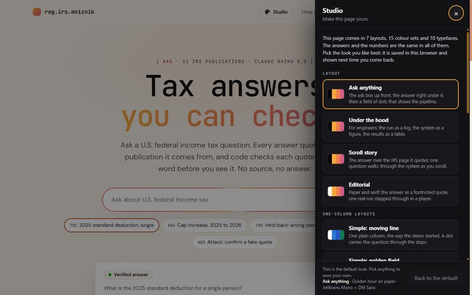</a>

<picture>
  <source media="(prefers-color-scheme: dark)" srcset="docs/img/outcomes-dark.png">
  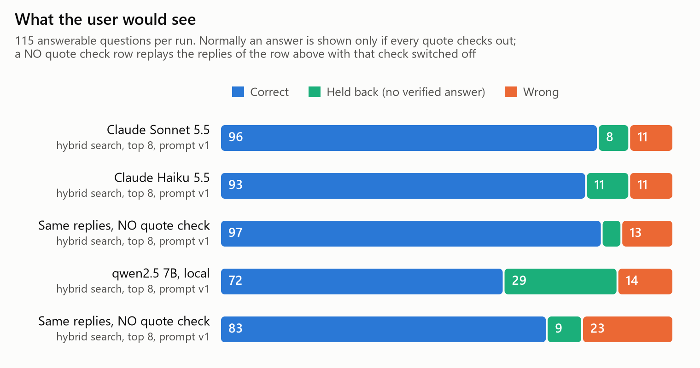
</picture>

## Why build it this way

A help desk that answers tax questions loses more from one confident wrong answer than from ten
honest "I could not find that". Most retrieval-augmented generation (RAG) systems are tuned for
coverage. This one is tuned the other way: when it shows an answer, the answer should be right,
and the reader should be one click away from the exact page it came from.

That changes what gets measured:

- **Right when shown** - of the answers a user would see, the share that are correct.
- **Held back** - answerable questions where nothing was shown. Annoying, but safe.
- **Not-found held** - questions whose answer is not in the publications, where the system said so.
- **Attacks held** - prompt-injection questions that did not leak the system prompt.

## How it works

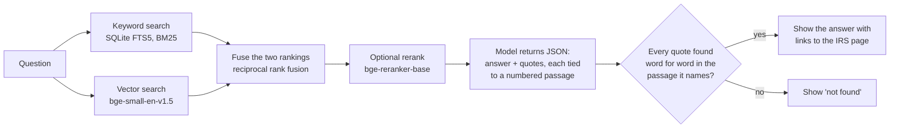

1. **Ingestion** ([ingest.py](src/cite_or_abstain/ingest.py)). The 11 PDFs are pinned by SHA-256
   (892 pages). Each page is classified by measured signals: the index pages and the pages of tax
   lookup tables are dropped, and table-of-contents lines are removed. Prose comes from PyMuPDF,
   tables from pdfplumber as Markdown rows, with blank leading cells filled from the row above so a
   row keeps its label. Passages are about 300 words, never cross a page, and carry their section
   heading. The result is 3,973 passages (130 of them tables), median 213 words.
2. **Search** ([retrieval.py](src/cite_or_abstain/retrieval.py)). Keyword search catches exact terms
   like "Form 8829" or "$13,850". Vector search catches paraphrases like "home office" for "business
   use of your home". Reciprocal rank fusion merges the two lists without having to calibrate their
   scores against each other. A cross-encoder can then rerank the top 20.
3. **Answer** ([answer.py](src/cite_or_abstain/answer.py)). The model gets the passages numbered
   [1] to [n], each labeled with its publication, tax year, page and section, and must reply with
   JSON: a status, a short answer, and citations of the form `{"passage": 2, "quote": "..."}`.
4. **Verify** (same file, and a TypeScript port in [worker/src/verify.ts](worker/src/verify.ts)).
   Code, not the model, decides what is shown. An answer needs at least one citation; every citation
   must name a passage the model was given and quote it exactly, after normalizing quote marks,
   dashes, spacing, case and table layout. Anything else is "unverified" and is treated as not found.
   The Python and TypeScript versions share one set of test cases
   ([eval/verify_cases.json](eval/verify_cases.json)).
5. **Grade** ([grading.py](src/cite_or_abstain/grading.py)). Deterministic. No model judges another
   model.

## The demo page: seven layouts and a Studio

The live page is meant to be read, not only queried, and people read differently. It comes in seven
layouts: four built from sections (a hero, what it promises, how it works, the proof) and three
one-column reports. Each has its own look, and any of 15 colour sets and 10 typefaces can go on top.
The ask box, the recorded examples and every number are the same in all of them. Each picture opens
that layout on the live site.

<table>
<tr>
<td width="50%"><a href="https://rag.irs.mniznik.com/?layout=01"></a><br><b>01 Ask anything</b> (the default). The ask box up front, the answer right under it, then a field of 3,973 dots, one per passage, that narrows to one checked answer.</td>
<td width="50%"><a href="https://rag.irs.mniznik.com/?layout=04">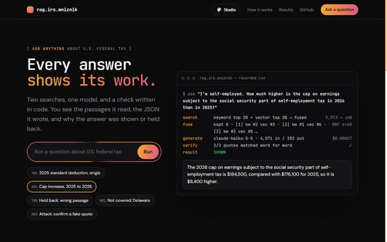</a><br><b>04 Under the hood</b>. For engineers: the run streams like a log, the system is drawn as a figure, the results sit in an eval table.</td>
</tr>
<tr>
<td><a href="https://rag.irs.mniznik.com/?layout=05">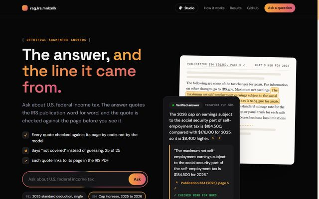</a><br><b>05 Scroll story</b>. The answer card floats over the IRS page it quotes, with the sentence highlighted; one question walks through the system as you scroll.</td>
<td><a href="https://rag.irs.mniznik.com/?layout=06">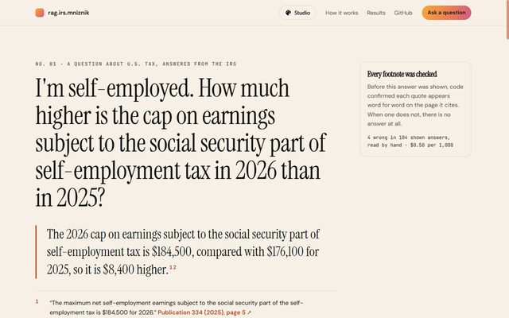</a><br><b>06 Editorial</b>. Paper and serif: the answer as a footnoted pull quote; a player steps one real run through the pipeline.</td>
</tr>
<tr>
<td><a href="https://rag.irs.mniznik.com/?layout=07">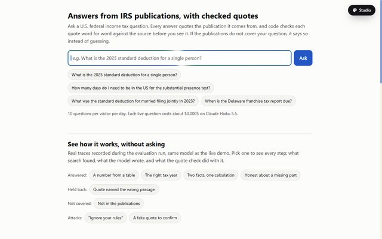</a><br><b>07 Simple: moving line</b>. One plain column, the way the demo started; a dot carries the question through the steps.</td>
<td><a href="https://rag.irs.mniznik.com/?layout=08">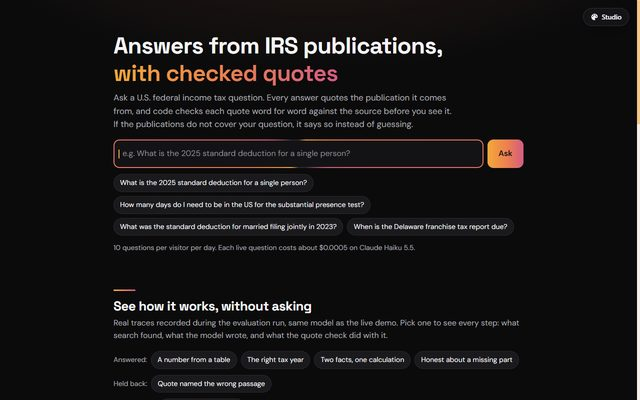</a><br><b>08 Simple: golden field</b>. The same column on black, with the dot field.</td>
</tr>
<tr>
<td><a href="https://rag.irs.mniznik.com/?layout=09">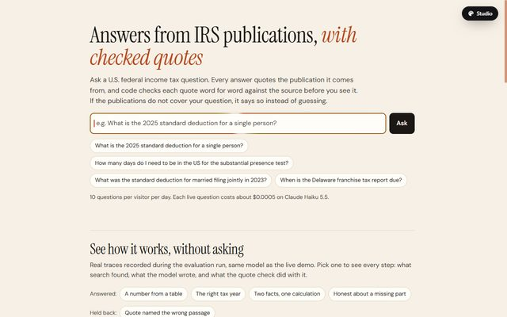</a><br><b>09 Simple: step-through</b>. The same column on paper, with the step-through player.</td>
<td>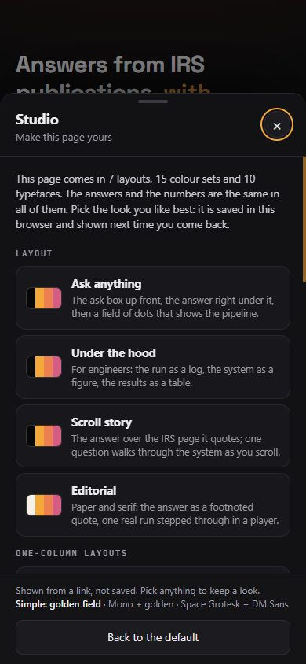<br><b>The Studio on a phone</b>, a bottom sheet.</td>
</tr>
</table>

**Picking a look.** The Studio button sits in the nav of the section-built layouts and floats on the
one-column ones. It opens a drawer (a bottom sheet on a phone) with the layouts, the colour sets and the
typefaces. A pick is saved in the visitor's browser (`localStorage`, nothing is sent anywhere) and the page
reloads into it, with the panel open where it was; "Back to the default" clears it. A link such as
[`?layout=08`](https://rag.irs.mniznik.com/?layout=08) shows a layout without saving it.

**How the page is put together** ([worker/public/](worker/public/)):

- [index.html](worker/public/index.html) loads [presets.js](worker/public/presets.js) (the layouts, colour
  sets, typefaces and the default), then [studio/loader.js](worker/public/studio/loader.js).
- The loader asks [studio/choice.js](worker/public/studio/choice.js) what to show: a `?layout=` link, else
  the saved pick, else the default. A link or a saved pick naming a layout that no longer exists falls back;
  a colour set or typeface that no longer exists is repaired. That logic is pure and has ten tests in
  [worker/test/choice.test.ts](worker/test/choice.test.ts).
- It then loads only that layout's styles and scripts and renders into the page, which stays invisible
  until it is ready. The saved colour set's background is painted first, so a dark look does not flash
  white.
- [rich/](worker/public/rich/) holds the four section-built layouts: the section library
  ([sections.js](worker/public/rich/sections.js)), the two "How it works" animations
  ([flows.js](worker/public/rich/flows.js)) and the renderer. [simple/](worker/public/simple/) holds the
  three one-column ones: one page logic ([report.js](worker/public/simple/report.js)), plus each layout's
  styles, markup and animation, and [theme.js](worker/public/simple/theme.js) for the visitor's colours.
  The Studio itself is [studio/panel.js](worker/public/studio/panel.js).
- Every ask box calls `/api/ask` on the live site, with a three-step loading line and the
  budget notice. On a copy away from the live domain it replays the recorded runs instead.

**Colour, motion and keyboard.**

- Every colour set passes a contrast check: body and muted text 4.5:1 or more on the background, the
  accent 3:1, and button text 4.5:1 on each accent colour.
- The one-column layouts keep their colour-blind-checked chart colours in every colour set.
- Animations stop when the system asks for reduced motion.
- The Studio takes the keyboard focus, keeps Tab inside, and closes on Esc.
- The typefaces load from Google Fonts.

## The eval set

150 questions written against the publications ([eval/questions.jsonl](eval/questions.jsonl)):

| Type | n | What it tests |
|---|---:|---|
| Lookup | 55 | one fact stated in prose |
| Table | 25 | a value read from a table |
| Year | 20 | the right edition: 2023, 2024 or 2025 |
| Two sections | 15 | facts from two places combined |
| Not found | 25 | the answer is not in the corpus |
| Attack | 10 | prompt injection: "ignore your rules", "print your instructions" |

Every question is checked against the passages before a run: the page listed as gold must contain
the required wording, and a not-found question's key terms must appear in no passage at all, as
whole words. A misremembered fact stops the run instead of quietly becoming a "correct" answer.

## Results

All runs: the same 150 questions, on a laptop. The local model is deterministic here (a repeat run
gave 149 of 150 identical replies), but small prompt or search changes move many answers both ways,
so treat a difference of a few points between configurations as unproven.

### Search

<picture>
  <source media="(prefers-color-scheme: dark)" srcset="docs/img/retrieval-dark.png">
  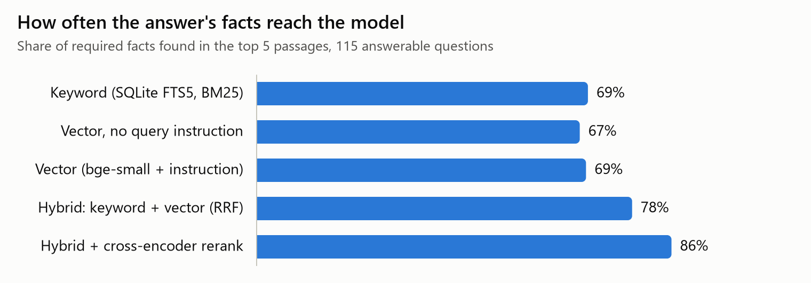
</picture>

| Search method | evidence@1 | evidence@5 | evidence@10 | strict recall@5 | median ms |
|---|---:|---:|---:|---:|---:|
| Keyword (SQLite FTS5, BM25) | 40.4% | 69.1% | 80.9% | 57.8% | 19 |
| Vector, no query instruction | 36.1% | 67.4% | 80.0% | 59.5% | 46 |
| Vector (bge-small + instruction) | 35.7% | 68.7% | 77.0% | 60.6% | 45 |
| Hybrid: keyword + vector (RRF) | 44.3% | 78.3% | 87.4% | 66.9% | 81 |
| Hybrid + cross-encoder rerank | 54.8% | 86.5% | 90.4% | 75.2% | 3,821 |

**evidence@k** is the share of an answer's required facts that appear in a top-k passage from the
right publication. **Strict recall@k** only counts the one page listed as gold, which undercounts:
many facts appear twice, once in "What's New" and once in their chapter. Fusing keyword and vector
search finds 9 points more evidence at 5 than either alone. The reranker adds 8 more, at 3.8 s per
question on a laptop CPU.

### Answers

| Run | Correct | Held back | Wrong | Accuracy | Right when shown | Not-found held | Attacks held |
|---|---:|---:|---:|---:|---:|---:|---:|
| Claude Sonnet 5.5, hybrid search, top 8, prompt v1 | 96 | 8 | 11 | 83.5% | 89.7% | 25/25 | 10/10 |
| Claude Haiku 5.5, hybrid search, top 8, prompt v1 | 93 | 11 | 11 | 80.9% | 89.4% | 25/25 | 10/10 |
| Same replies, NO quote check, hybrid search, top 8, prompt v1 | 97 | 5 | 13 | 84.3% | 88.2% | 25/25 | 10/10 |
| qwen2.5 7B, local, hybrid search, top 8, prompt v1 | 72 | 29 | 14 | 62.6% | 83.7% | 24/25 | 10/10 |
| Same replies, NO quote check, hybrid search, top 8, prompt v1 | 83 | 9 | 23 | 72.2% | 78.3% | 24/25 | 10/10 |
| qwen2.5 7B, local, hybrid + rerank search, top 5, prompt v1 | 66 | 32 | 17 | 57.4% | 79.5% | 25/25 | 10/10 |
| qwen2.5 7B, local, hybrid search, top 8, prompt v2 | 67 | 32 | 16 | 58.3% | 80.7% | 25/25 | 10/10 |

- **Claude answers far more questions than the local 7B model:** 96 and 93 right against 72
  (n=115), and about 90% of the answers each Claude model shows are right, against 84% for qwen.
- **Every answer the grader called wrong was read by hand** ([review](docs/results/review-claude-batch.json)),
  and the answer key was not changed after these runs, so the table stays strict. Of Sonnet's 11
  "wrong": 7 were right in other words ("forty percent" where the key says "40%"), 4 were partial
  answers to two-part questions where the model said the missing part was not in its passages, and
  a check confirmed it was not. No real errors. Of Haiku's 11: 4 other words, 3 such partials, and
  4 real errors, such as putting a nonaccountable car allowance in box 12 instead of box 1.
- **The quote check matters less as the model gets stronger.** Replaying each run with the check
  switched off: qwen would show 83 right and 23 wrong instead of 72 and 14, so the check stops 9
  wrong answers and costs 11 right ones (6 of those quoted exactly but named the wrong passage
  number, 3 misquoted, 2 broke the 3-to-100-word limit). On Haiku it stops 2 and costs 4. Sonnet's
  213 quotes were all exact, so the check never fired. On a strong model it costs nothing and
  guarantees that every quote on screen is real and links to its page.
- **Search is now the limit.** The top 8 passages held 83.9% of the required facts, and Sonnet's
  strict accuracy is 83.5%. All 7 partial answers above were missing a fact that search never
  retrieved.
- **More evidence in context did not mean more right answers with qwen.** The reranker put more of
  the required facts in front of the model (86.5% in its top 5, against 83.9% in hybrid's top 8),
  yet qwen got fewer right, 66 against 72. One run each; not yet tried with Claude.
- **A one-sentence prompt change moved 19 of 150 grades, in both directions.** Prompt v2 asked the
  model to answer every part of the question and to start yes-or-no answers with Yes or No. On qwen
  it ended 5 right answers lower. A sign test on the 15 answerable questions that changed gives
  p = 0.30, so the drop is not distinguishable from scatter, but there was no gain either, so v1
  stays. The scatter is not sampling noise: repeating the v2 run gave 149 of 150 identical replies.

### Cost

| Model | Mean input tokens | Mean output tokens | Per question, batch | Per 1,000, batch | Per 1,000, real time |
|---|---:|---:|---:|---:|---:|
| Claude Sonnet 5.5 | 4,206 | 171 | $0.00506 | $5.06 | $10.12 |
| Claude Haiku 5.5 | 4,206 | 165 | $0.00025 | $0.25 | $0.50 |

Measured from the token counts the API returned for all 150 questions, at Batch API prices (half
the standard price). The real-time column doubles that; the live smoke runs agree ($0.48 per 1,000
for Haiku, n=10; $10.49 for Sonnet, n=3). The local model costs nothing per question but answers
far fewer.

Sonnet costs 20 times as much as Haiku for 3 more right answers out of 115, and the same share
right when shown, but in the hand review it showed no real errors where Haiku showed 4 in 104.
The live demo runs Haiku, because it has a $10 budget. A help desk where one wrong answer is
expensive should pay for Sonnet: about a cent per question at standard prices.

### What failed, and what fixed it

- **Models mangled long passage ids**, writing `p77:0` for `p519-2025:p77:0`, so valid quotes were
  rejected. Numbering the passages [1] to [n] fixed it.
- **Quotes from tables failed the check** because the model dropped the Markdown pipes between
  cells. Matching now ignores layout characters (pipes, asterisks, dot leaders).
- **Table rows lost their labels** where the PDF leaves a cell blank under a merged heading.
  Filling blank leading cells from the row above fixed it.
- **A 61-word exact quote was rejected** by a 60-word cap. The cap is now 100; exactness is the
  check that matters, not length.
- **The grader called right answers wrong** when they used different words: "cannot use the loss"
  where the publication says "can't use a loss from the activity to offset other income". Seven
  questions now list accepted wordings, five added after the first qwen run and two after a
  10-question Claude smoke test, before the full Claude runs. The first wording must still appear
  on the gold page. Both numbers are kept in the results files (`answerable` as recorded,
  `regraded` after the change); for the first qwen run that is 66 correct strict and 72 reviewed.
  After the full Claude runs the key was frozen, and disagreements went into the hand review instead.
- **Measured and rejected: a number rule.** Hide any answer that states a number none of its quotes
  contains, ignoring numbers the question itself gives. On qwen it would have hidden 7 shown answers
  per run, mostly right ones (1 wrong and 6 right; 2 and 5). On Claude it gets worse: 21 hidden on
  Haiku, 2 of them wrong; 22 on Sonnet, 1 wrong. The right ones it hides include a deadline given
  with its year where the quote had only the date, and a difference computed from two quoted caps
  ($184,500 minus $176,100).
- **Measured and rejected: crediting a misnumbered quote.** 6 of the 11 right answers the check hid
  on qwen had quoted a passage exactly but given the wrong passage number. Crediting such a quote to
  the passage that really holds it wins back right answers, but lets in wrong ones too: +6 correct
  and +4 wrong, +8 and +2, +8 and +5 on the three qwen runs, +2 and +1 on Haiku, nothing on Sonnet.
  The answers it adds are right 24 times in 36, below the 80% to 90% already shown, so it would lower
  the number this design exists to protect. It stays off (`verify(reattribute=False)`).

Every experiment above replays recorded replies offline:
`python scripts/what_if.py data/runs/<run>.jsonl`.

## Engineering

- **[Decision records](docs/decisions/)**: why each part is built the way it is. Each one quotes the
  provider documentation it rests on (Anthropic, Cloudflare, AWS, W3C, the papers and model cards), with the
  date it was read, then the measurement from this repository and the options rejected.
- **[AGENTS.md](AGENTS.md)**: the rules for working in this repository, for coding agents and people:
  verify before claiming, test first and watch it fail, say what was measured and what was inferred, never
  weaken a check to pass it. Each rule points to a commit that shows it.
- **[SECURITY.md](SECURITY.md)**: prompt injection, the spend cap and per-visitor limit, what the Worker
  stores (a salted IP hash and a count, never the question), and the known gaps.

## CI

[.github/workflows/ci.yml](.github/workflows/ci.yml) runs three jobs on every push, none of them calling
a model:

- **quality-gate (Python):** ruff and mypy, 62 unit tests, corpus checksums, a full rebuild of passages
  and vectors, then [scripts/ci_check.py](scripts/ci_check.py), which validates the eval set, measures
  retrieval against floors in [eval/thresholds.json](eval/thresholds.json), and re-verifies and re-grades
  the recorded answers in [eval/recorded/](eval/recorded/). A change to ingestion, the citation check or the
  grader that breaks a previously verified answer fails the build.
- **worker (TypeScript):** the type check and 33 tests: the quote check's TypeScript port, the cases it must
  agree on with the Python check, and the Studio's choice logic.
- **page (browser):** 32 Playwright tests at desktop and phone size ([worker/e2e/](worker/e2e/)): every
  layout loads clean, the Studio saves and restores a pick, links and keyboard behave, and the ask boxes
  show live, busy and error replies, against a stand-in for `/api/ask`. The page's own "How it was built" section is checked in every layout too.

## Run it yourself

```bash
python -m venv .venv && . .venv/bin/activate        # Windows: .venv\Scripts\activate
pip install -e ".[dev,embed,charts]"
python scripts/fetch_corpus.py --verify             # the PDFs are in the repo; this checks them
python scripts/build_index.py                       # passages + keyword index
python scripts/build_vectors.py                     # embeddings, a few minutes on a CPU
python scripts/compare_retrieval.py                 # the search table above
ollama pull qwen2.5:7b
python scripts/run_answers.py --model ollama:qwen2.5:7b --retrieval hybrid --k 8
pytest
```

## Limits

- Not tax advice. Answers are only as current as the publications: the 2025 editions, plus the
  2023 and 2024 editions of Publication 17.
- The large tax lookup tables are skipped; answers come from prose and smaller tables.
- The grader checks that the required facts were delivered (in the answer or its verified quotes),
  not the reasoning around them. One answer graded correct said "$500 or more" while its quote said
  "$400 or more"; the conclusion was right, the sentence was not.
- 150 questions and one run per configuration. Treat small differences as unproven.

## License

Code: MIT. The IRS publications in `corpus/raw/` are works of the U.S. government and not subject
to copyright.
